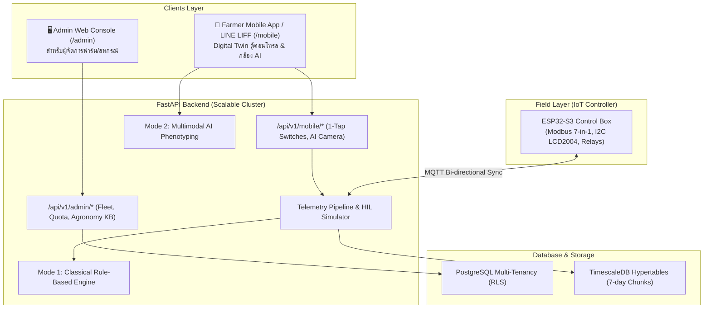

# 🍌 Smart Banana IoT & AI Platform (กล้วยหอมทอง - Kluai Hom Thong)
> **Precision Agriculture & AI Platform: Fruit Weight Maximization**
> ระบบ IoT และ AI สำหรับการบริหารจัดการแปลงใหญ่กล้วยหอมทองเพื่อการส่งออก เพิ่มผลผลิตและน้ำหนักผลเกรดพรีเมียม

[](https://fastapi.tiangolo.com)
[](https://timescale.com)
[](https://espressif.com)
[](https://mqtt.org)

---

## 🎯 วัตถุประสงค์และสรีรวิทยากล้วยหอมทอง (Domain Knowledge)
1. **ระบบรากฝอยตื้น (0–40 ซม.):** ขาดน้ำไม่ได้แต่กลัวน้ำท่วมขัง (เสี่ยงโรคตายพราย Fusarium oxysporum)
2. **ความต้องการธาตุอาหาร:** ต้องการโพแทสเซียม (K) สูงที่สุดในช่วงเลี้ยงผล (สัดส่วน N:P:K = 1 : 0.5 : 4) ดึงแป้งและน้ำตาลเข้าผล เพิ่มความหนาของเปลือกและขยายขนาดผล
3. **ความอ่อนไหว:** ทนเค็มต่ำมาก ($EC_e \le 0.85\text{ dS/m}$, Hard Cutoff $1.0\text{ dS/m}$) และลำต้นไม่มีเนื้อไม้แท้ ลมกระโชกแรง $>30\text{ km/h}$ จะทำให้ต้นหักโค่นช่วงติดผล

---

## 🏗️ สถาปัตยกรรมระบบ (Architecture Overview)



---

## 📦 ตู้คอนโทรล 6 แถว (Control Box Front Panel) & Digital Twin

```
┌──────────────────────────────────────────────────────────┐
│              SMART BANANA IOT CONTROLLER                 │
├──────────────────────────────────────────────────────────┤
│ แถว 1: [               จอ LCD 2004 (I2C)               ] │
│        T:31.0C  RH:72% S:3 | Soil:74.5% pH:6.2 | EC:0.58  │
├──────────────────────────────────────────────────────────┤
│ แถว 2:  🔴 AC 220V         🟢 DC 24V         🟢 DC 12V   │
│         (ไฟสถานะไฟบ้าน)    (โซลินอยด์วาล์ว)   (บอร์ด/เซนเซอร์)│
├──────────────────────────────────────────────────────────┤
│ แถว 3:      [🟡 ปั๊มน้ำ]                 [🟡 ปั๊มปุ๋ย]      │
│             (สวิตช์กด)                   (สวิตช์กด)      │
├──────────────────────────────────────────────────────────┤
│ แถว 4:       🟡 RUN                      🟡 RUN          │
│          (ไฟสถานะปั๊มน้ำ)             (ไฟสถานะปั๊มปุ๋ย)     │
├──────────────────────────────────────────────────────────┤
│ แถว 5:  [🟢 โซน 1]    [🟢 โซน 2]    [🟢 โซน 3]    [🟢 โซน 4] │
│         (สวิตช์)      (สวิตช์)      (สวิตช์)      (สวิตช์)    │
├──────────────────────────────────────────────────────────┤
│ แถว 6:   🟢 ZONE 1     🟢 ZONE 2     🟢 ZONE 3     🟢 ZONE 4 │
│         (ไฟสถานะ)     (ไฟสถานะ)     (ไฟสถานะ)     (ไฟสถานะ)   │
└──────────────────────────────────────────────────────────┘
```

- **Fail-safe Power Diagnosis:** แยกไฟแสดงผล AC 220V, DC 24V (วาล์ว), DC 12V (บอร์ด/เซนเซอร์)
- **Bi-Directional MQTT Sync:** กดสวิตช์หน้าตู้จริง $\leftrightarrow$ สวิตช์ในมือถือ LINE LIFF เด้งเปลี่ยนสถานะพร้อมกันภายใน $< 0.2$ วินาที

---

## 🚀 การเริ่มต้นใช้งาน (Getting Started)

### 1. รัน Backend API & Web Portals
```bash
# ติดตั้ง dependencies
pip install -r backend/requirements.txt

# รันเซิร์ฟเวอร์
cd backend
python -m uvicorn app.main:app --host 0.0.0.0 --port 8000 --reload
```
หรือดับเบิลคลิกไฟล์ `run_server.bat` บน Windows

### 2. URL สำคัญ
- **Gateway Portal:** [http://localhost:8000](http://localhost:8000)
- **Enterprise Admin Console:** [http://localhost:8000/admin](http://localhost:8000/admin)
- **Farmer Mobile App (LINE LIFF):** [http://localhost:8000/mobile](http://localhost:8000/mobile)
- **Interactive Swagger Docs:** [http://localhost:8000/docs](http://localhost:8000/docs)

---

## 📁 โครงสร้างโปรเจกต์ (Project Structure)
```
BANANAFARM/
├── backend/
│   ├── app/
│   │   ├── api/v1/         # API Routers (admin, mobile, telemetry, control, ai_vision)
│   │   ├── core/           # Config, DB connections
│   │   ├── models/         # SQLAlchemy 2.0 Multi-tenant Models
│   │   ├── schemas/        # Pydantic v2 DTOs
│   │   ├── services/       # Rule Engine, ET0 Calculator, AI Phenotyping, Simulator
│   │   ├── templates/      # Admin Web & Mobile LINE LIFF HTMLs
│   │   └── main.py         # Application Entrypoint & WebSockets
│   └── requirements.txt
├── database/
│   └── 01_init_schema.sql  # PostgreSQL + TimescaleDB DDL
├── firmware/
│   ├── esp32_banana_controller.ino  # Production Arduino C++ Firmware
│   └── README_WIRING.md             # Complete Electrical & Pinout Manual
├── docker-compose.yml      # TimescaleDB Container setup
├── run_server.bat          # 1-Click Launch Script
└── README.md
```

---

## 🛡️ License & Credits
พัฒนาเพื่อเกษตรกรแปลงใหญ่กล้วยหอมทองเพื่อการส่งออก (Precision Agriculture IoT & AI Platform).
# BANANA

